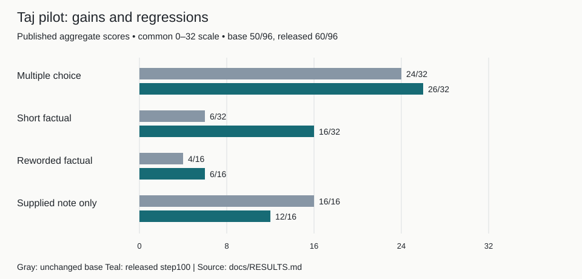

<h1 align="center">Taj Mahal History Tutor 4B</h1>

**Try an experimental English Taj Mahal tutor and inspect both the gains and regressions from its LoRA training.**

[Demo or published artifacts](https://huggingface.co/OmTheLast/taj-mahal-history-tutor-4b-experimental)

Qwen3-4B base. Transformers, MLX, and experimental GGUF exports. Private training/evaluation records are excluded; factual errors remain.

By Om Patnaik · repository created September 2026.

[](LICENSE)

## Install

| Platform / path | Start here |
| --- | --- |
| Transformers export | [Download reference weights](https://huggingface.co/OmTheLast/taj-mahal-history-tutor-4b-experimental) |
| MLX / GGUF | Use the model repository’s `mlx-adapter/` or experimental `gguf/` format |

Install a runtime compatible with your chosen format, download the public model, and follow `examples/chat_transformers.py`. Ask a short factual question and check it against a trusted source. Inspect the saved result report without downloading weights.

```bash
python scripts/verify_repository.py  # inspect public artifacts before loading weights
```

## Why

You want to learn whether a small history fine-tune can improve recall without damaging other answer behaviour. This pilot fine-tunes Qwen3-4B-Instruct-2507 on Taj Mahal exercises. It is a recipe experiment, not a curriculum-complete history tutor.

## Results



The recorded total rises from 50/96 to 60/96; open factual questions improve from 10/48 to 22/48 while supplied-note answers fall from 16/16 to 12/16.

Rebuild with `python scripts/plot_readme_results.py`. [Published score inputs](docs/figures/readme-results.json) · [Result report](docs/RESULTS.md).

## Choose the export deliberately

Transformers safetensors are the reference export; original MLX adapters and Q6_K GGUF are alternate artifacts with their own runtime conditions. The public examples describe loading, not a guarantee of identical output across formats.

## Read the failed candidates

Later narrow repairs sometimes moved errors to older wordings. A step250 candidate exceeded the predeclared broad-regression allowance and was not released. Frozen questions, source passages, and raw provider traces are deliberately private.

## Notes from building it

I found that unique facts and question variation mattered more than raw row count. Validation loss alone did not select the best answer behaviour, and narrow repairs could cause regressions. I would keep the frozen promotion gates and require independent source-cleared evaluation before expanding the subject.

## Commands

```bash
python examples/chat_transformers.py       # run the public reference export
python scripts/verify_repository.py        # check public artifact boundaries
python scripts/plot_readme_results.py      # rebuild the published result chart
```

## Verify it yourself

```bash
python scripts/verify_repository.py
```

The verifier checks the public repository’s artifact boundary; it does not rerun the private benchmark. Full training needs omitted source-cleared data, manifests, and evaluation records, as explained in [reproducibility notes](docs/REPRODUCIBILITY.md).

## Credits, license and pointers

Built on Qwen3-4B-Instruct-2507 and MLX/Transformers. Luna drafted exercises and Muse Spark 1.3 Free critiqued them; coordination and source/evaluation decisions remained with the project owner. [Apache-2.0](LICENSE); model-assisted review is not historical certification.

[Full setup, original notes, and project history](README-DETAILS.md).
